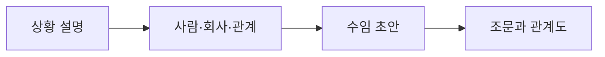
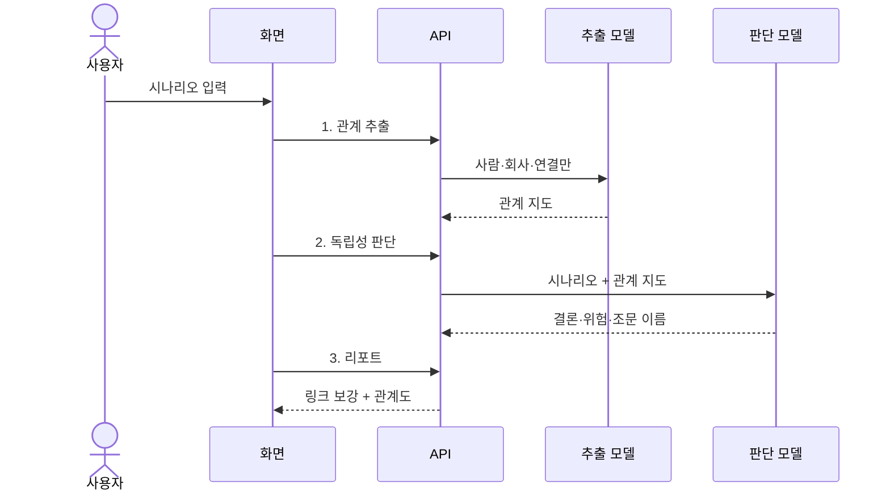
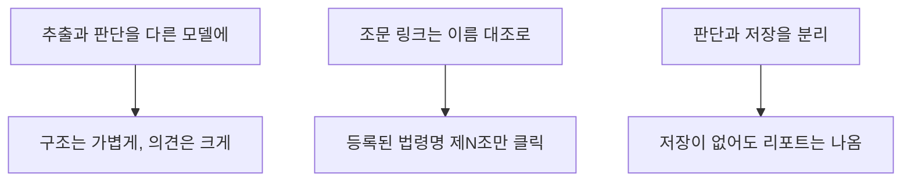

# ⚖️ [audit-chat] 감사 독립성 검토 AI

시나리오 한 편을 넣으면 **결론, 근거 조문, 관계도**가 한 화면에 나옵니다.  
회계사가 독립성 규정을 적용하기 전에 보는 **검토 초안**입니다. 최종 수임 판단은 전문가의 몫입니다.

[![데모 영상][demo-thumb]][demo-video]

이미지를 누르면 데모 영상으로 이동합니다.

---

## 한 줄로 보면

독립성 규정은 “누가 누구와 어떤 사이인가”로 갈립니다.  
그 글을 사람이 매번 읽고 조문을 찾으면, 관계와 근거가 흩어집니다.

이 도구는 그 순서를 고정합니다.



| 받는 것 | 뜻                                           |
| ------- | -------------------------------------------- |
| 결론    | 수임 불가 · 안전장치를 두면 가능 · 수임 가능 |
| 근거    | `법령명 제N조`. 등록된 이름과 맞을 때만 링크 |
| 관계도  | 인물·회사·연결을 한 장의 그림으로            |

---

## 단계별 처리 흐름

검토 내용 입력 → 관계 정보 추출 → 독립성 검토 → 보고서 표시



| 단계   | 하는 일                         | 모델        |
| ------ | ------------------------------- | ----------- |
| 추출   | 인물·회사·연결만 고름           | GPT-4o mini |
| 판단   | 지도 위에서 수임 의견을 씀      | GPT-4o      |
| 리포트 | 조문 링크와 Mermaid 그림을 붙임 | 호출 없음   |

같은 글을 다시 넣으면 관계 지도는 Neo4j에서 재사용합니다.  
Neo4j가 없어도 리포트는 만들어집니다. 저장 실패는 판단을 막지 않습니다.

---

## 주요 구성

다음 세 가지 원칙에 따라 구성했습니다.



1. **추출과 판단은 다른 모델입니다.** 관계 추출은 형식이 중요해서 가볍고 온도 0입니다. 수임 의견은 더 큰 모델이 담당합니다.
2. **링크는 이름 대조입니다.** `공인회계사법 제33조`처럼 등록된 표기만 열립니다. 주제 설명이나 “확인 필요” 문장은 글자로만 남습니다.
3. **판단과 저장은 분리되어 있습니다.** Neo4j는 같은 시나리오의 관계 지도를 다시 쓰는 저장소입니다. 연결이 없거나 저장이 실패해도 추출과 판단은 그대로 끝납니다.

검토 시각은 서버에 저장하지 않습니다. 리포트가 그려질 때의 브라우저 시각이고, 눈 아이콘으로 숨기거나 볼 수 있습니다. 기본은 숨김입니다.

---

## 실행

Python 3.11, OpenAI API 키. Neo4j는 관계 지도를 다시 쓸 때만 필요합니다.

```bash
git clone https://github.com/psych3ma/audit-chat.git
cd audit-chat
make venv && source venv/bin/activate
cp .env.example .env   # OPENAI_API_KEY 입력
./run.sh
```

| 여는 곳   | 주소                       |
| --------- | -------------------------- |
| 검토 화면 | http://localhost:8000      |
| API 문서  | http://localhost:8000/docs |

화면 문구·로고를 바꾼 뒤에는 `cd web && npm run build`로 정적 페이지를 다시 만듭니다.

---

## 이 초안이 하지 않는 일

- 법령 원문을 검색해 조문 번호를 검증하지 않습니다. 모델이 고른 이름을, 등록표와 맞춰 링크만 붙입니다.
- 수임 가능 여부를 법적으로 확정하지 않습니다.
- `.env`의 API 키는 저장소에 올리지 않습니다.

더 짧은 프론트 설명은 [`web/README.md`](web/README.md)에 있습니다.

[demo-thumb]: data/assets/audit-chat_img.png
[demo-video]: https://youtu.be/WPOpcItps0M
